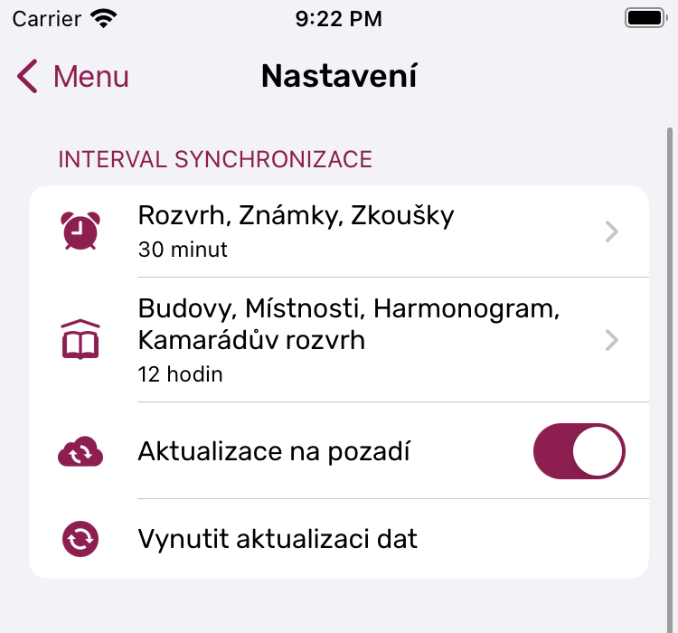

# Univerzita Help

The in-app Help of the Univerzita iOS app (both its UIs), written as Markdown, plus the images the topics show.

- `topics/cs/`, `topics/en/`: one file per topic and language, with the same file name in both.
- Images sit at the repository's root (or in a folder) and are referenced by their path.
- On every push to `main`, the [Help workflow](.github/workflows/help.yml) checks every topic, builds
  `help_cs.json` and `help_en.json` and publishes them on GitHub Pages. The app downloads them from
  `https://czernas.github.io/StagAppHelp/help_<lang>.json` when they've changed. A pull request is only checked.

## Writing a topic

```markdown
---
category: Začínáme        # the category's title in this language
categoryOrder: 2          # where the category sits, the same in both languages
order: 1                  # where the topic sits in its category, the same in both languages
title: Jak aplikace pracuje s daty?
icon: lock.shield         # an SF Symbol, or an image here: icons/timetable.png
---

## An open section

Text with **bold**, _italic_ and [a link](https://example.com).

- a list item
- another one

### A section folded until tapped


```

- `##` starts a section shown open, `###` one folded under its heading until tapped.
- Paragraphs in a row are one block. A single plain paragraph is shown as text, anything else as formatted text.
- HTML written in the Markdown is passed through as it is.

## Checking locally

```sh
python3 scripts/build_help.py --check   # validates only
python3 scripts/build_help.py           # also writes build/help_cs.json and build/help_en.json
```

The check fails when a topic has no front matter or content, an image or icon isn't in the repository, a topic exists
in only one language, or a category's or topic's place differs between the languages.
